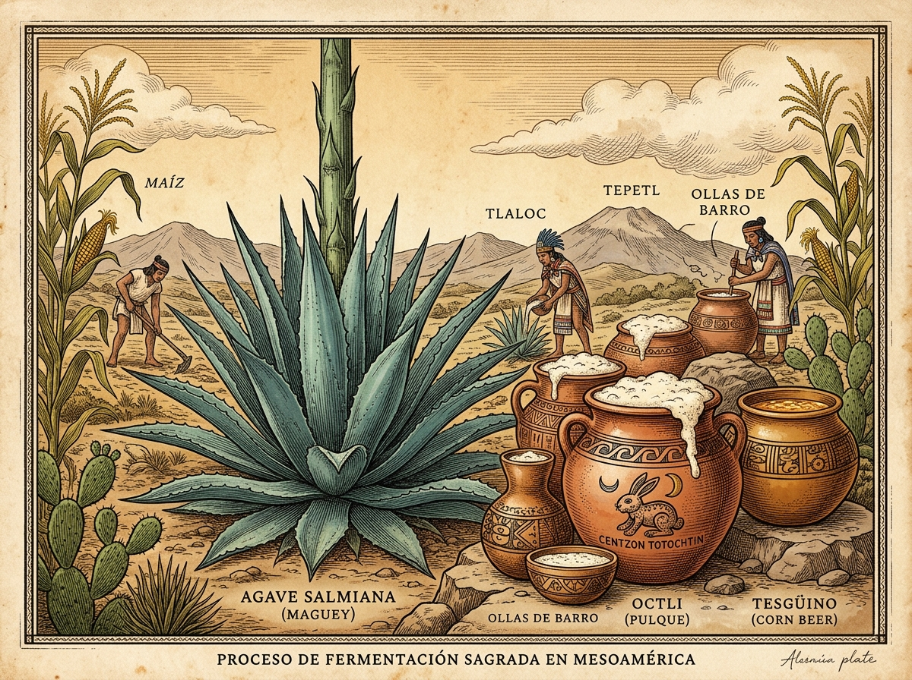

::: {.web-hero style="padding: 2.5rem 1rem; margin-bottom: 2rem;"}
::: {.hero-badge}
Ensayo Biocultural &amp; Microbiológico
:::

# El «Hervor Frío»

### La matriz biocultural de las fermentaciones en Mesoamérica y el mundo cervecero

::: {.origin-card-illustration style="max-width: 520px; margin: 1.5rem auto;"}
{.origin-card-img alt="Lámina: Mayahuel, vasijas de fermentación y la espuma del octli y el tesgüino"}
:::

::: {.hero-meta-chips}
::: {.meta-chip}
🔬 ***Zymomonas mobilis* &amp; *Saccharomyces***
:::
::: {.meta-chip}
🌾 **Almidón vs. Azúcares Libres**
:::
::: {.meta-chip}
🌿 **Lúpulo &amp; *Ocpatli***
:::
::: {.meta-chip}
🐇 **Los 400 Conejos (*Centzon Totochtin*)**
:::
:::
:::

---

## 1. El «Fuego sin Llama»: La Ontología de la Efervescencia

En la cosmovisión mesoamericana, el fuego del fogón (*tlexochtli*) transforma los alimentos mediante calor exterior, mientras que la fermentación opera como un **hervor frío** (*pozonallotl*): un proceso autónomo donde la materia líquida adquiere respiración, murmura, se entibia sutilmente sin fuego y engendra espuma viviente.

El vocablo náhuatl *pozonallotl* (espuma efervescente) comparte raíz con *pozonqui* (lo que hierve o se esponja) y con bebidas rituales como el *pozonque* o el *pozol*. Para los pueblos originarios, la espuma no era un subproducto técnico desechable ni mero gas carbónico ($CO_2$), sino la **evidencia sensible de la animación (*tonalli*)** habitando el brebaje. Esta devoción estética y religiosa por la espuma unía al cacao ceremonial batido vigorosamente con molinillos, al aguamiel recién espumado por la fermentación y a las cervezas de maíz tierno.

---

## 2. El Espectro Biotecnológico: Dos Sendas hacia el Etanol

La humanidad resolvió la producción de bebidas fermentadas a través de dos caminos marcados por la arquitectura molecular de los vegetales:

```text
                  ┌──────────────────────────────────────────────┐
                  │       EL GRADIENTE DE LA FERMENTACIÓN        │
                  └──────────────────────┬───────────────────────┘
                                         │
                 ┌───────────────────────┴───────────────────────┐
                 ▼                                               ▼
   [ POLO ECOLÓGICO / ESPONTÁNEO ]               [ POLO ARQUITECTÓNICO / GRANO ]
   Sustrato: Azúcares simples libres             Sustrato: Polisacáridos complejos
   (Sacarosa, Glucosa, Fructosa)                 (Almidón: amilosa y amilopectina)
   
   • Dinámica: Captura inmediata                 • Dinámica: Despolimerización enzimática
   • Agente microbiano: Bacterias + Levaduras    • Agente microbiano: Levaduras (Saccharomyces)
   • Ejemplos Mesoamericanos:                    • Ejemplos Mesoamericanos:
     - Pulque (Agave salmiana, A. atrovirens)      - Tesgüino (Zea mays germinado)
     - Taberna (Acrocomia aculeata, coyol)         - Sendecho (Maíz malteado y tostado)
     - Balché (Miel Melipona + Lonchocarpus)       - Tepache arcaico (maíz tierno)
     - Colonche (Opuntia streptacantha, tuna)    • Paralelos del Viejo Mundo:
   • Paralelos del Viejo Mundo:                    - Sikaru sumerio (Cebada / Trigo)
     - Vinos de uva silvestre                      - Cervezas Ale y Lager (Malteado)
     - Hidromiel salvaje                           - Sake japonés (sacarificación por moho)
```

### 2.1 La senda silvestre: El monopolio bacteriano de *Zymomonas mobilis*

El caso del pulque es microbiológicamente insólito a escala global. Mientras que la casi totalidad de las fermentaciones alcohólicas de la historia han estado comandadas por hongos eucariotas (*Saccharomyces*), el aguamiel es colonizado por una bacteria procarionte: ***Zymomonas mobilis*** (antiguamente descrita como *Termobacterium mobile*).

* **La ruta Entner-Doudoroff:** A diferencia de las levaduras cerveceras, que emplean la clásica glucólisis (Embden-Meyerhof-Parnas), *Z. mobilis* utiliza la vía de Entner-Doudoroff. Esta ruta metabólica rinde únicamente 1 molécula de ATP por molécula de glucosa (frente a 2 en levaduras), lo que obliga a la bacteria a devorar azúcares a una velocidad vertiginosa para sostenerse energéticamente, liberando etanol y dióxido de carbono casi al doble de la velocidad de una levadura ordinaria.
* **El trío sinfónico del aguamiel:** El pulque no es una monocultura, sino un consorcio trifásico vivo:
  1. *Fase alcohólica:* *Zymomonas mobilis* y levaduras silvestres (*Saccharomyces cerevisiae*, *Kluyveromyces*).
  2. *Fase ácida:* Bacterias ácido-lácticas (*Lactobacillus acidophilus*, *Leuconostoc mesenteroides*), que descienden el pH a 3.5–4.0, protegiendo la bebida de enterobacterias patógenas.
  3. *Fase viscosa:* Cepas de *Leuconostoc* sintetizan dextranos y exopolisacáridos a partir de la sacarosa, otorgándole al pulque su textura sedosa y cuerpo característico.

### 2.2 La senda del grano: El maíz como cereal cervecero

En las regiones áridas y serranas donde el maguey pulquero no prosperaba o donde el maíz regía la cosmología, los pueblos indígenas desarrollaron **auténtica tecnología cervecera de malteado**:

* **Tesgüino (Rarámuri y Tepehuano):** Los granos de maíz se humedecen y se colocan en canastas o pozos cubiertos con ramas de pino en la oscuridad. Durante varios días, el grano despierta y germina. Este proceso activa las enzimas endógenas **alfa y beta amilasas**, que rompen las largas cadenas de almidón en azúcares fermentables (maltosa, maltotriosa y glucosa). Posteriormente, el maíz germinado se muele, se hierve en ollas comunales durante horas y se inocula con catalizadores silvestres o levaduras residuales de ollas anteriores.
* **Sendecho (Mazahua y Otomí):** El maíz de variedades pigmentadas (negro, azul o rosa) se maltea de forma similar, pero se somete a un secado y tostado ligero al sol o en comal, produciendo compuestos de Maillard equivalentes a las **maltas caramelo o tostadas** de las cervezas oscuras europeas (Porters y Stouts), resultando en una bebida rojiza, densa y nutritiva.

---

## 3. Botánica Reguladora: Del Lúpulo al *Ocpatli* y el *Balché*

Uno de los grandes desafíos técnicos de la cerveza histórica fue evitar que se agriara o se pudriera antes de consumirse. En Europa, la respuesta tardó milenios en consolidarse hasta la adopción del **lúpulo** (*Humulus lupulus*), difundido en el siglo XII por Hildegarda de Bingen gracias a las propiedades bacteriostáticas de sus resinas y alfa-ácidos.

En Mesoamérica se descubrió el mismo principio protector utilizando la farmacopea nativa:

| Función Técnica | En la Cerveza Tradicional Europea | En el Sistema Fermentativo Mesoamericano |
|-----------------|-----------------------------------|------------------------------------------|
| **Agente bacteriostático / Conservador** | Lúpulo (*Humulus lupulus*): inhibe bacterias que avinagran el mosto. | **Raíz de Ocpatli** (*Acacia angustissima* o *Calliandra grandiflora*): rica en taninos y compuestos fenólicos que seleccionan la microbiota y evitan putrefacciones. |
| **Clarificación y selectividad** | Flor de lúpulo e iris moss (*Chondrus crispus*). | **Corteza de Balché** (*Lonchocarpus violaceus*): sus flavonoides clarifican la miel fermentada y actúan como antiséptico selectivo. |
| **Aporte de amargor / Balance sensorial** | Alfa y beta ácidos isomerizados (isohumulona). | Alcaloides y resinas de raíces y cortezas medicinales que balanceaban el dulzor del aguamiel o del mosto de maíz. |
| **Inóculo y persistencia microbiana** | Varillas de levadura (*Kveikstokk* en Noruega), sedimentos y barricas de roble. | Ollas porosas de barro curado, zurrones de cuero de venado (*tinacales*) y *back-slopping* con "semilla" (*madre*). |

---

## 4. Filosofía del Estado Alterado: Los 400 Conejos (*Centzon Totochtin*)

En la cosmovisión mexica, el pulque (*octli*) estaba tutelado por la diosa **Mayahuel** (el cuerpo vegetal generoso) y por su consorte **Pátecatl** (el dios de las raíces y la medicina que cura y fermenta). De su unión nacieron los **Centzon Totochtin** (los 400 Conejos de la Embriaguez), encabezados por *Ometochtli* (Dos Conejo).

El número 400 en náhuatl (*centzontli*) no era meramente contable, sino sinónimo de **incontable, infinito y multifacético**. Los antiguos sabios comprendían que el alcohol no producía una sola embriaguez homogénea, sino una diversidad de desdoblamientos anímicos:

* El conejo que llora y busca consuelo.
* El conejo cantor que alegra el banquete.
* El conejo iracundo que busca disputa.
* El conejo soñador que se retira a contemplar las estrellas.
* El conejo bromista que todo lo vuelve risa.

Esta taxonomía psicológica es extraordinariamente contemporánea: reconoce la interacción entre la **farmacología del fermento**, el **entorno social (*set & setting*)** y la **personalidad individual**, advirtiendo sobre el respeto reverencial que merecía toda sustancia capaz de alterar la conciencia.

---

## 5. El Lazo Bioquímico Compartido: La Enzima `ADH4` y la Dieta Humana

Tanto el consumidor de cerveza en Mesopotamia y Baviera como el bebedor de pulque en Teotihuacán y el bebedor de tesgüino en la Sierra Madre Occidental están unidos por un evento paleogenético ocurrido hace unos 10 millones de años: la mutación **A294V en la enzima Alcohol Deshidrogenasa 4 (`ADH4`)**.

Esta mutación multiplicó por 40 la capacidad de nuestros ancestros primates para metabolizar etanol de frutos caídos en el suelo de la selva. La fermentación humana no nació como una indulgencia superflua, sino como una tecnología vital:
1. **Preservación calórica:** Almacenar el exceso estacional de azúcares antes de su putrefacción.
2. **Seguridad microbiológica:** El alcohol y los ácidos orgánicos purifican el agua en entornos sin saneamiento.
3. **Enriquecimiento vitamínico:** Las levaduras y bacterias sintetizan vitaminas del complejo B (tiamina, riboflavina, niacina) y aminoácidos esenciales ausentes en el grano crudo o en la savia virgen.

---

## 6. Conclusión: Hacia una Cultura de la Fermentación sin Fronteras

La cerveza artesanal contemporánea y las bebidas tradicionales de los pueblos originarios no son artefactos de mundos opuestos. Son capítulos complementarios de una **misma historia evolutiva y cultural**.

Apreciar la turbidez viva de una *Hazy IPA* o la fermentación mixta de una *Gueuze* belga debería hermanarse de forma natural con el aprecio por la viscosidad probiótica de un buen pulque de tinacal o la nobleza telúrica de un *sendecho* mazahua. Ambas tradiciones celebran la paciencia, el respeto por los tiempos biológicos y la eterna fascinación humana ante el misterio de la espuma.

---

## 📚 Referencias Documentales

1. **Carrigan, M. A., Uryasev, O., Frye, C. B., et al. (2015).** *Hominids adapted to metabolize ethanol with a Pleistocene mutation in alcohol dehydrogenase 4*. PNAS, 112(2), 458-463.
2. **Escalante, A., Giles-Gómez, M., Hernández-Guzmán, G., et al. (2016).** *Pulque Fermentation: An Insight into the Microbial Diversity and Dynamics of One of the Oldest Traditional Mexican Fermented Beverages*. Frontiers in Microbiology, 7, 1184.
3. **Kennedy, J. G. (1978).** *Tarahumara of the Sierra Madre: Beer, Ecology, and Social Organization*. AHM Publishing Corporation.
4. **McGovern, P. E. (2009).** *Uncorking the Past: The Quest for Wine, Beer, and Other Alcoholic Beverages*. University of California Press.
5. **Sahagún, Fray Bernardino de (1577 [1985]).** *Historia general de las cosas de la Nueva España*. Editorial Porrúa, México.
6. **Lappe-Oliveras, P., Moreno-Terrazas, R., Arrizón-Gaviño, J., et al. (2008).** *Yeasts associated with the production of Mexican alcoholic beverages: pulque, mezcal, and tequila*. FEMS Yeast Research, 8(7), 1037-1052.
